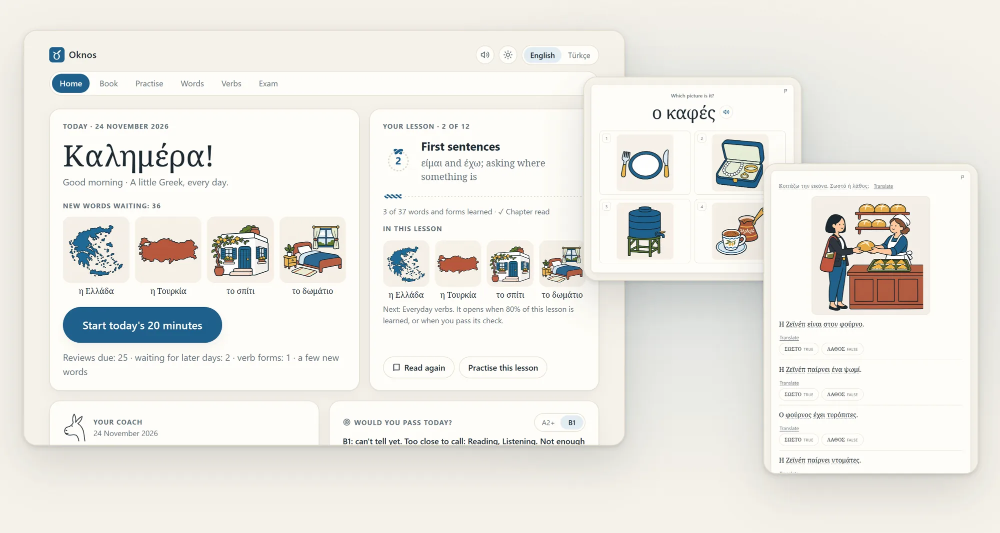
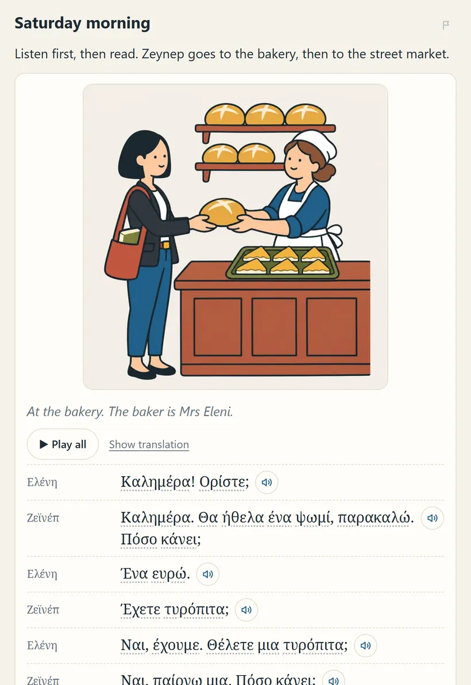
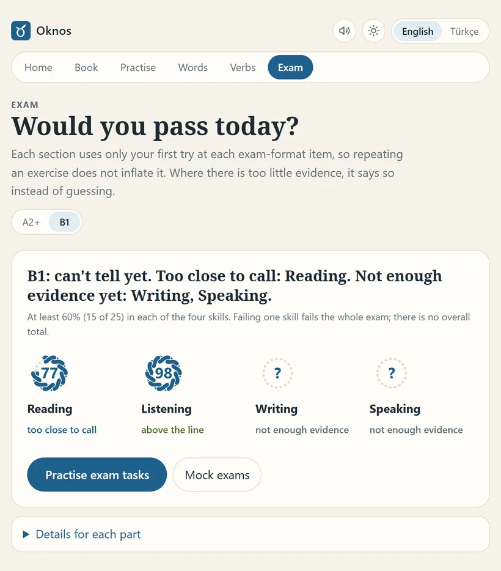
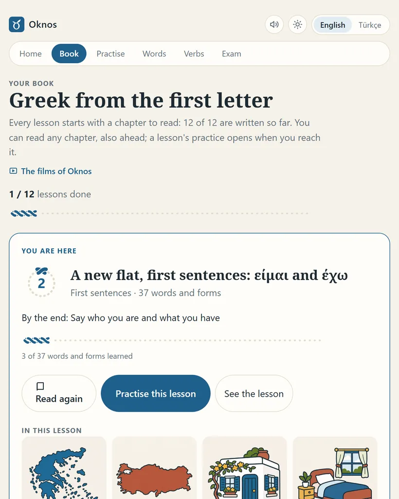
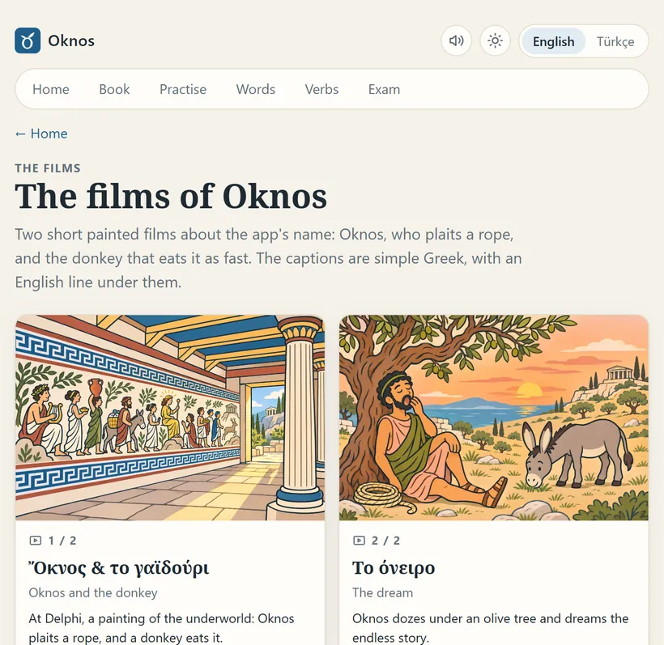
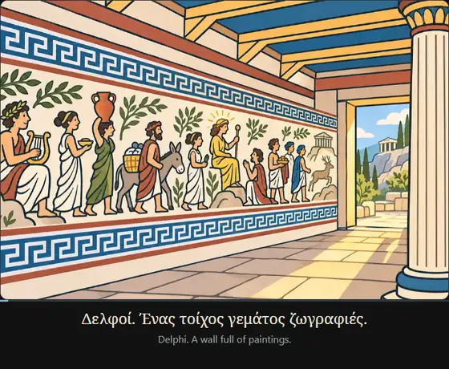

  <picture>
    <source media="(prefers-color-scheme: dark)" srcset="docs/brand/oknos-lockup-dark.svg">
    
  </picture>

<h3 align="center">Learn Greek the lazy way. Your agent does the rest.</h3>

<em>You plait the rope. The donkey carries the load.</em>

  <picture>
    <source media="(prefers-color-scheme: dark)" srcset="docs/img/hero-dark.webp">
    
  </picture>

**Oknos** is a Greek learning app for people who live in Greece and need a Greek certificate: the **A2 + history** exam for long-term residence, or **Ελληνομάθεια B1**. It is made for people who have tried to study before and stopped. It runs only on your own computer, and your coding agent (Claude Code, Codex or similar) installs it, runs it and coaches you.

> **Türkçe:** Uygulama Türkçe ve İngilizce. Bu sayfayı Türkçe okumak için ajanına "README'yi Türkçeye çevir" demen yeterli.

## Get started

Install an agent such as the Claude desktop app (Claude Code) or Codex, sign in, and say:

> **"Download `https://github.com/<owner>/oknos` and set it up for me."**

The agent installs what is needed, starts the app and puts an **Oknos** shortcut on your desktop. After that, double-click **Oknos** whenever you want to study; you don't need the agent open for that. (Already have the code? Open the folder in your agent and say "set this up for me". The agent's steps are in [`.agents/skills/setup/SKILL.md`](.agents/skills/setup/SKILL.md).)

## A look inside

<table>
  <tr>
    <td width="50%" valign="top"><picture><source media="(prefers-color-scheme: dark)" srcset="docs/img/app-reader-dark.webp"></picture></td>
    <td width="50%" valign="top"><picture><source media="(prefers-color-scheme: dark)" srcset="docs/img/app-picture-dark.webp"></picture></td>
  </tr>
  <tr>
    <td align="center"><b>Read first.</b> Each lesson starts with a short chapter: a story, its dialogue spoken aloud, grammar explained in Turkish or English. Tap any Greek word for its meaning.</td>
    <td align="center"><b>Then practise.</b> A session sized to your time, with a natural voice, and pictures for the words. Reviews come back just before you would forget.</td>
  </tr>
  <tr>
    <td valign="top"><picture><source media="(prefers-color-scheme: dark)" srcset="docs/img/app-scene-dark.webp"></picture></td>
    <td valign="top"><picture><source media="(prefers-color-scheme: dark)" srcset="docs/img/app-exam-dark.webp"></picture></td>
  </tr>
  <tr>
    <td align="center"><b>Exam formats from day one.</b> Look at the picture: true or false? Gap fills, matching, listening, writing and speaking, as in the real exams.</td>
    <td align="center"><b>Would you pass today?</b> An honest answer per skill, against each exam's real pass rule. With too little evidence, it says so.</td>
  </tr>
  <tr>
    <td valign="top"><picture><source media="(prefers-color-scheme: dark)" srcset="docs/img/app-book-dark.webp"></picture></td>
    <td valign="top"><picture><source media="(prefers-color-scheme: dark)" srcset="docs/img/app-films-dark.webp"></picture></td>
  </tr>
  <tr>
    <td align="center"><b>A book of twelve lessons.</b> From the alphabet to B1, following Zeynep from Izmir as she settles in Thessaloniki.</td>
    <td align="center"><b>Films about the name.</b> Two short painted films of the myth, with Greek captions to read along.</td>
  </tr>
</table>

Screens from a demo learner with the open content only. Light or dark follows your system.

## Why "Oknos"?

In a painting at Delphi described by Pausanias, **Oknos** (Ὄκνος, "sloth" or "hesitation") sits plaiting a rope while a donkey eats it as fast as he plaits it. That is what happens to the Greek you learn and never review. In this app the donkey is on your side: your agent carries the load, so the rope gets longer. More in [docs/brand](docs/brand/README.md).

### The films

  

Two short painted films (about 45 seconds each) tell the story: **Oknos and the donkey**, from Pausanias, and **The dream**, where Oknos dozes under an olive tree. The captions are simple modern Greek with an English or Turkish line under them, so they are reading practice too, and they can play with a Greek voice and a quiet background of wind, cicadas and goat bells. The first film welcomes you the first time you open the app; both are on the films page, reached from the home screen and the Book. How they are made: [docs/brand/animations](docs/brand/animations/README.md).

## How it works

<picture>
  <source media="(prefers-color-scheme: dark)" srcset="docs/img/how-it-works-dark.svg">
  
</picture>

- The app runs at `http://127.0.0.1:8642`, only on your computer. Your progress, mistakes and writing stay in a local folder. There are no accounts and nothing is uploaded.
- You study in the app every day. The agent is not needed for that.
- When you open your agent, it reads how you have been doing and acts as your coach. It makes new exercises around your weak spots and from your own life, marks your writing against the exam's criteria, and turns what you did in class, or a letter you received, into practice. If you agree, it also prepares tomorrow's exercises every evening by itself.

## A day with Oknos

<picture>
  <source media="(prefers-color-scheme: dark)" srcset="docs/img/a-day-dark.svg">
  
</picture>

## What you learn

<picture>
  <source media="(prefers-color-scheme: dark)" srcset="docs/img/what-you-learn-dark.svg">
  
</picture>

- **The Oknos book**, an open course in 26 stages: reading Greek, 24 lessons and a bridge to B1. Each starts with a chapter to read, and its practice opens after it. A new word is shown and explained before it is ever tested. A shorter course of 12 chapters, with a story running through it, is there too and adds its words and scenes to the book's lessons.
- **Pictures and a voice.** Painted scenes in every chapter, and pictures for words: over a hundred in the open course and close to a thousand in all, drawn for Oknos. Every Greek sentence of the open course comes with a natural recorded voice, so it sounds right from the first day with no setup. With your own key for a voice service (Azure, Google or OpenAI) the agent can voice everything else too.
- **Podcast lessons** to listen to on the go: your agent writes an episode for a chapter, in Greek with explanations in Turkish or English, and voices it with your voice service.
- **Exam practice in the real formats**, a timed **mock exam**, and an honest answer to **"would you pass today?"** for each part of each exam.
- **Your own material**, if you have it. Import a coursebook you own, a word list or handouts, and they become your course. They stay private, on your computer.
- **On your phone too**, if you want: through your own private network (Tailscale), never the open internet. See [docs/HOSTING.md](docs/HOSTING.md).

## Say it to your agent

Open your agent in the Oknos folder and say:

| You say | What happens |
|---|---|
| **"coach"** or "how am I doing?" | How it is going, your two or three weakest areas, feedback on your writing, and next week's exercises already in the app. |
| **"tutor"** or "role-play the landlord" | A short conversation in Greek at your level, also from your phone. |
| **"today in class we did…"** | Practice built from your lesson, or from a letter or photo you drop in `learner/inbox/`. |
| **"mark my writing"** | Corrections and an exam score, shown in the app next to what you wrote. |
| **"make me a plan"** | A week-by-week plan to a real exam date, which says plainly whether it is realistic. |
| **"give me a mock exam"** | A full mock in the exam's format, timed, then marked. |
| **"make the podcast for this lesson"** | An audio lesson of the chapter, on the app's Podcast page. |
| **"any exam dates?"** | The official pages are checked and the next dates go on the home screen. |
| **"import my book"** | Your own material becomes a private course. |

## Honest by design

- No streaks, no badges, no points. The home screen shows the one next thing to do and where you are.
- Readiness uses only your first try at each exam-format item, so repeating an exercise does not inflate it.
- Everything the agent writes in Greek is checked before you see it, and anything that looks wrong can be flagged with one tap.
- Local only: no accounts, no tracking, no cloud. A voice service, if you choose one, is sent the Greek text to read and nothing about you.

Status: early. Used every day by its maintainer on Windows; the macOS and Linux installs are written but untested.

## For developers

Everything is in [docs/DEVELOPING.md](docs/DEVELOPING.md): the commands, how the code is laid out, and the documents behind it. Coding agents start from [AGENTS.md](AGENTS.md).

## Licences and thanks

- Code: MIT ([`LICENSE`](LICENSE)). Content in `content/open/` (the course, the book, the pictures): CC BY-SA 4.0 ([`content/open/LICENSE.md`](content/open/LICENSE.md)). The films and their sound: CC BY-SA 4.0.
- The open content's voice clips (`content/open-voice/`) were made with Google Cloud Text-to-Speech and are shared under CC BY-SA 4.0.
- Verb forms and the word index use the English Wiktionary's Greek entries (CC BY-SA), as extracted by [kaikki.org](https://kaikki.org).
- The wordmark is drawn from Noto Serif (SIL Open Font Licence).
- The name comes from Pausanias, *Description of Greece* 10.29.
