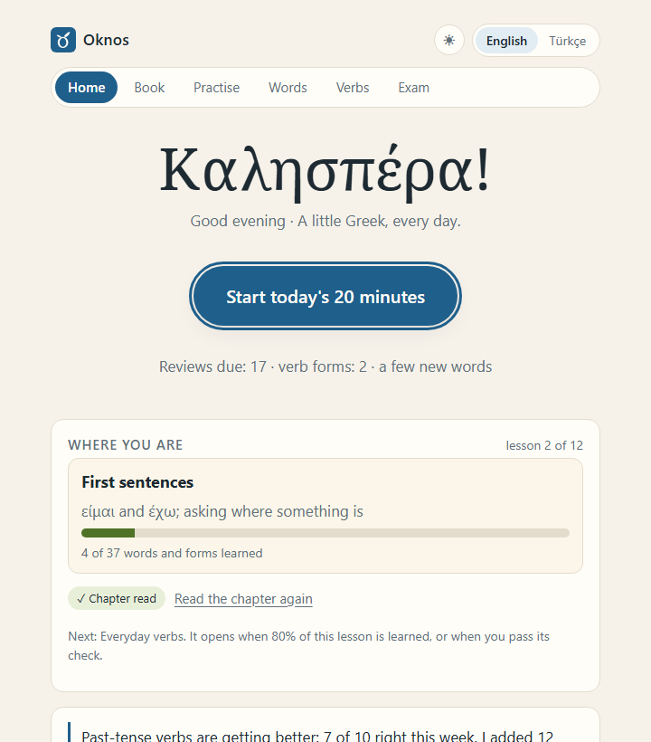
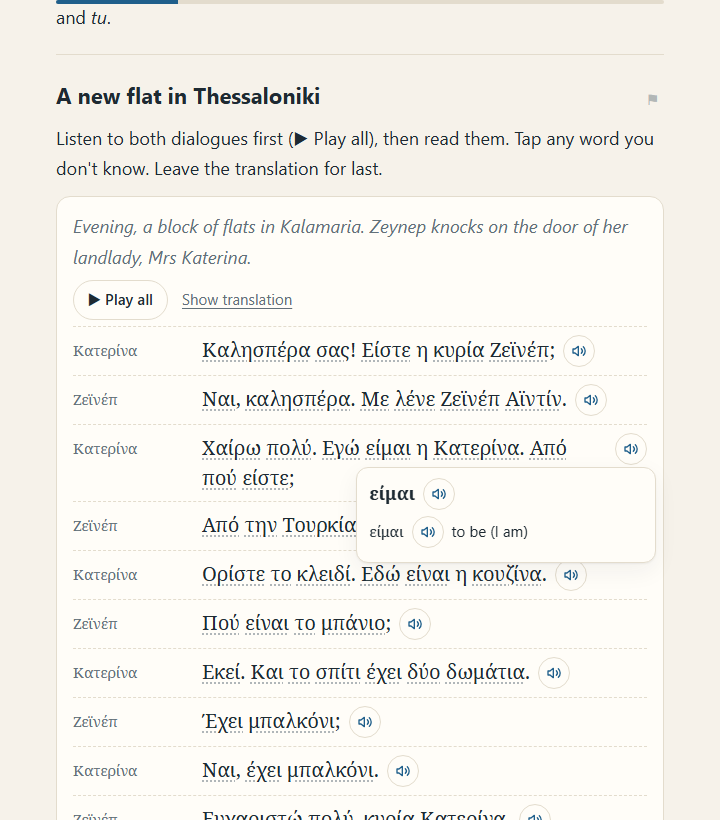
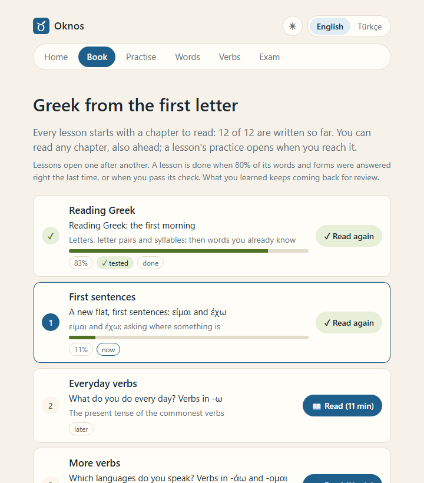
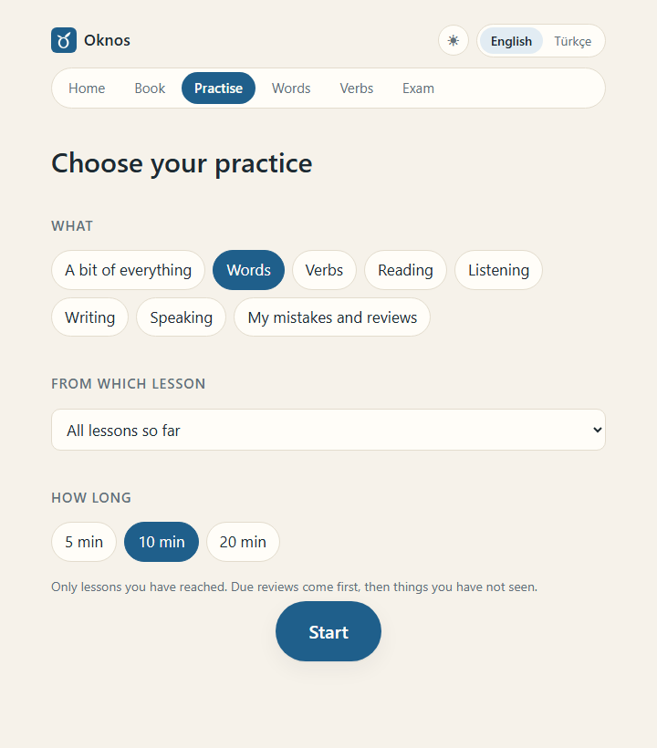
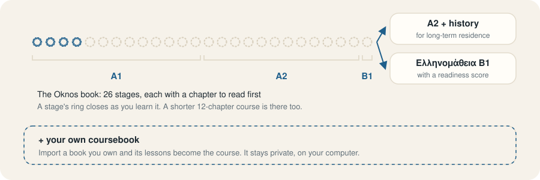

  <picture>
    <source media="(prefers-color-scheme: dark)" srcset="docs/brand/oknos-lockup-dark.svg">
    
  </picture>

<h3 align="center">Learn Greek the lazy way. Your agent does the rest.</h3>

<em>You plait the rope. The donkey carries the load.</em>

**Oknos** is a Greek learning app for people who live in Greece and need a Greek certificate: the **A2 + history** exam for long-term residence or **Ελληνομάθεια B1**. It is for people who have tried to study before and stopped. It runs only on your own computer, and your coding agent (Claude Code, Codex or similar) installs it, runs it and coaches you.

> **Türkçe:** Bu sayfayı Türkçe okumak için ajanına "README'yi Türkçeye çevir" demen yeterli. Uygulamanın kendisi Türkçe ve İngilizce.

<table>
  <tr>
    <td width="50%"></td>
    <td width="50%"></td>
  </tr>
  <tr>
    <td align="center">One button a day: the session is sized to your time</td>
    <td align="center">Read first, then practise. Tap any word for its meaning</td>
  </tr>
  <tr>
    <td></td>
    <td></td>
  </tr>
  <tr>
    <td align="center">A book of short chapters, from the alphabet to B1</td>
    <td align="center">Or choose: words, verbs, reading, listening, writing, speaking</td>
  </tr>
</table>

## Why "Oknos"?

In a painting at Delphi described by Pausanias, **Oknos** (Ὄκνος, "sloth" or "hesitation") sits plaiting a rope while a donkey eats it as fast as he plaits it. That is what happens to the Greek you learn and never review. In this app the donkey is on your side: your agent carries the load, so the rope gets longer. More in [docs/brand](docs/brand/README.md).

## How it works

<picture>
  <source media="(prefers-color-scheme: dark)" srcset="docs/img/how-it-works-dark.svg">
  
</picture>

- The app runs at `http://127.0.0.1:8642`, only on your computer. Your progress, mistakes and writing stay in a local folder. There are no accounts and nothing is uploaded.
- You study in the app every day. The agent is not needed for that.
- When you open your agent, it reads how you have been doing and acts as your coach. It makes new exercises around your weak spots and from your own life, marks your writing against the exam's criteria, and turns what you did in class, or a letter you received, into practice. If you agree, it can also prepare tomorrow's exercises every evening by itself.

## A day with Oknos

<picture>
  <source media="(prefers-color-scheme: dark)" srcset="docs/img/a-day-dark.svg">
  
</picture>

## What you learn

<picture>
  <source media="(prefers-color-scheme: dark)" srcset="docs/img/what-you-learn-dark.svg">
  
</picture>

- **An open course in 12 stages**, from the alphabet to B1. Each stage starts with a short chapter to read (a dialogue, grammar explained in Turkish or English, the words), and its practice opens after it.
- **Exam practice in the real formats**, a timed **mock exam**, and an honest answer to **"would you pass today?"** for each part of each exam, against its real pass rule. Where there is too little evidence, it says so instead of guessing.
- **Your own material**, if you have it. Import a coursebook you own, a word list or handouts, and they become your course. They stay private, on your computer.

## Say it to your agent

Open your agent in the Oknos folder and say:

| You say | What happens |
|---|---|
| **"coach"** or "how am I doing?" | How it is going, your two or three weakest areas, feedback on your writing, and next week's exercises already in the app. |
| **"tutor"** or "role-play the landlord" | A short conversation in Greek at your level, also from your phone. |
| **"today in class we did…"** | Practice built from your lesson, or from a letter or photo you drop in `learner/inbox/`. |
| **"mark my writing"** | Corrections and an exam score, shown in the app next to what you wrote. |
| **"make me a plan"** | A week-by-week plan to a real exam date, which says plainly whether it is realistic. |
| **"give me a mock exam"** | A full mock in the exam's format, timed, then marked. |
| **"any exam dates?"** | The official pages are checked and the next dates go on the home screen. |
| **"import my book"** | Your own material becomes a private course. |

## Get started

1. Install an agent such as the Claude desktop app (Claude Code) or Codex, and sign in.
2. In a new session, say: **"Download `https://github.com/<owner>/oknos` and set it up for me."**
3. The agent installs what is needed, starts the app and puts an **Oknos** shortcut on your desktop.

After that, double-click **Oknos** whenever you want to study. You don't need the agent open for that.

If you already have the code, open the folder in your agent and say "set this up for me". The steps the agent follows are in [`.agents/skills/setup/SKILL.md`](.agents/skills/setup/SKILL.md).

## Honest by design

- No streaks, no badges, no points. The home screen shows what is due and where you are.
- Readiness uses only your first try at each exam-format item, so repeating an exercise does not inflate it.
- Everything the agent writes in Greek is checked before you see it, and anything that looks wrong can be flagged with one tap.
- Local only: no accounts, no tracking, no cloud.

Status: early. Used every day by its maintainer on Windows; the macOS and Linux installs are written but untested.

## For developers

Everything is in [docs/DEVELOPING.md](docs/DEVELOPING.md): the commands, how the code is laid out, and the documents behind it. Coding agents start from [AGENTS.md](AGENTS.md).

## Licences and thanks

- Code: MIT ([`LICENSE`](LICENSE)). Content in `content/open/`: CC BY-SA 4.0 ([`content/open/LICENSE.md`](content/open/LICENSE.md)).
- Verb forms and the word index use the English Wiktionary's Greek entries (CC BY-SA), as extracted by [kaikki.org](https://kaikki.org).
- The wordmark is drawn from Noto Serif (SIL Open Font Licence).
- The name comes from Pausanias, *Description of Greece* 10.29.
