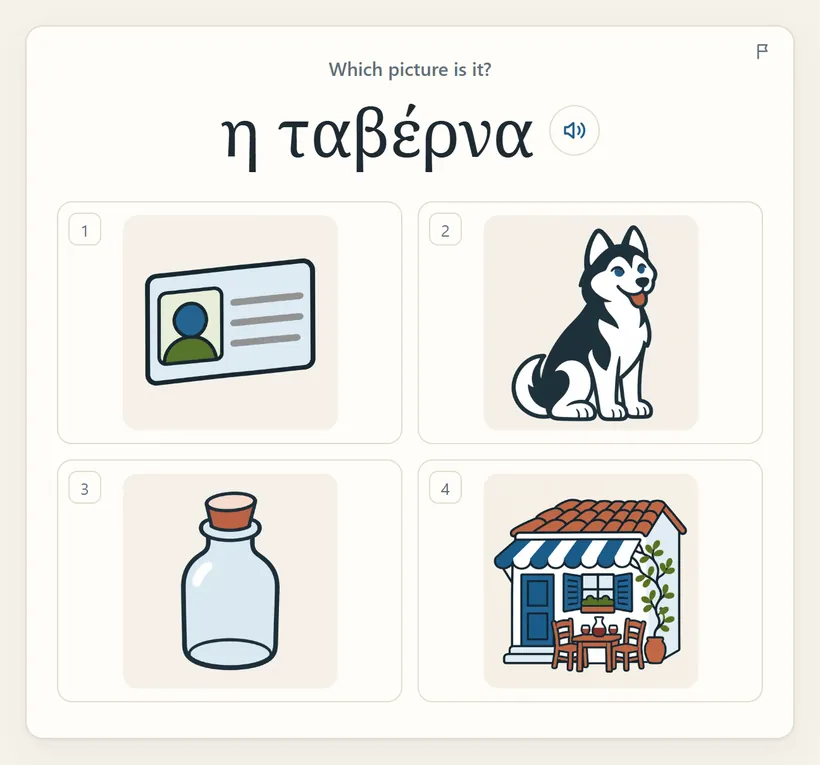
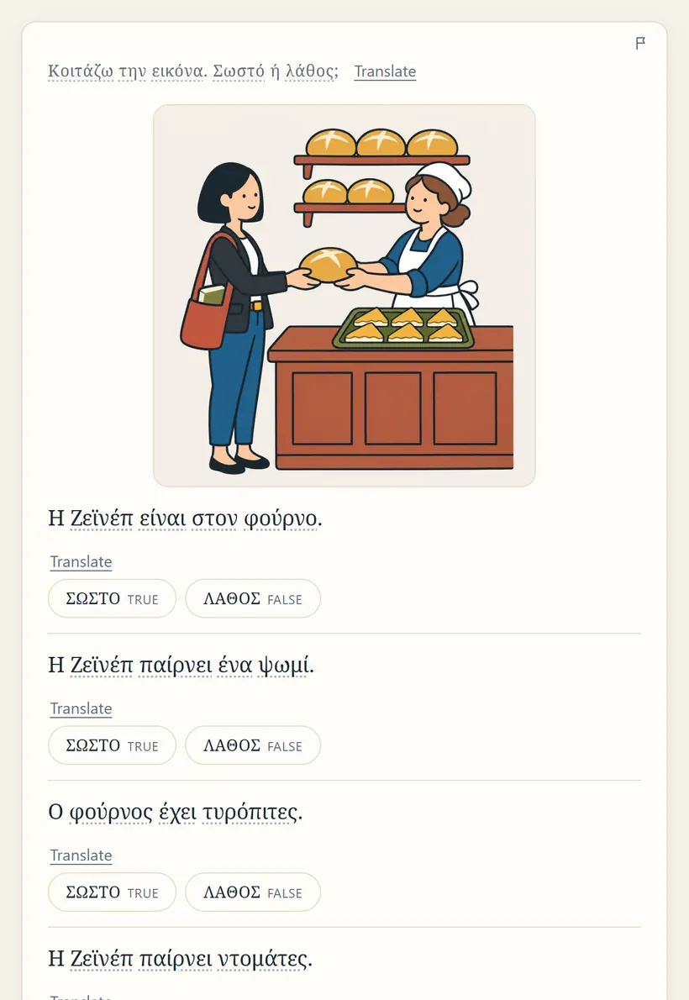
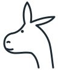
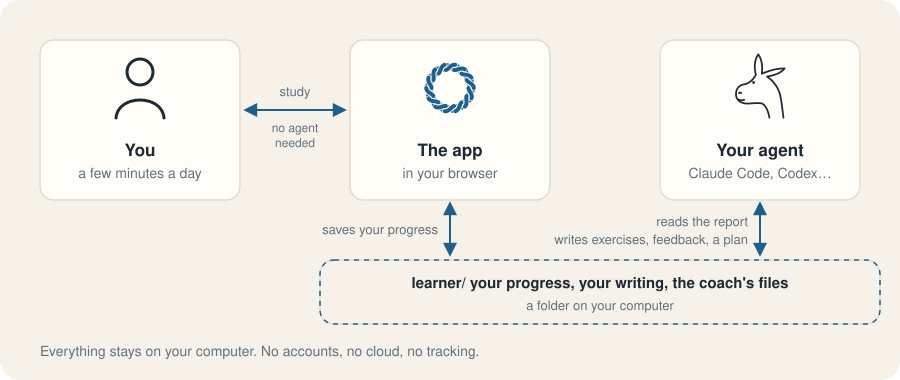
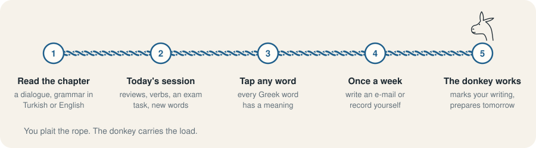
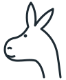
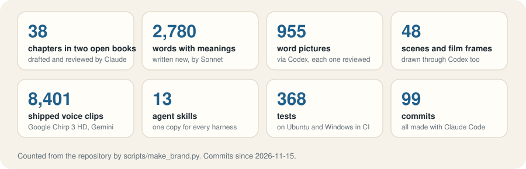
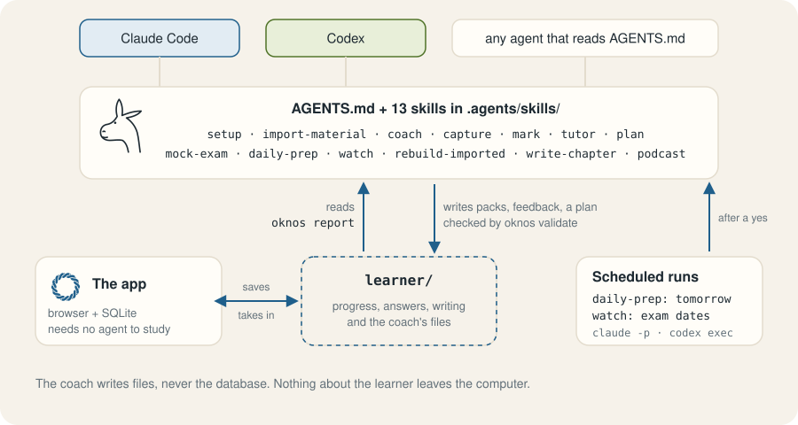
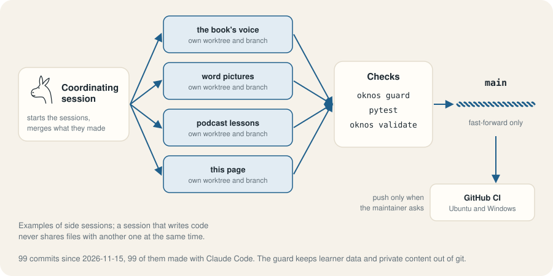

<p align="center">
  <picture>
    <source media="(prefers-color-scheme: dark)" srcset="docs/brand/oknos-lockup-dark.svg">
    
  </picture>
</p>

<h3 align="center">Learn Greek the lazy way. Your agent does the rest.</h3>
<p align="center"><em>You plait the rope. The donkey carries the load.</em></p>

<p align="center">
  <picture>
    <source media="(prefers-color-scheme: dark)" srcset="docs/img/hero-dark.webp">
    
  </picture>
</p>

<p align="center"><a href="#get-started"><b>I want to learn Greek</b></a> &nbsp;·&nbsp; <a href="#built-and-run-by-agents"><b>I want to see how agents build it</b></a></p>

<p align="center">
  <a href="#the-stack"></a>
  <a href="LICENSE"></a>
  <a href="content/open/LICENSE.md"></a>
  
</p>

**Oknos** is a Greek learning app for people who live in Greece and need a Greek certificate: the **A2 + history** exam for long-term residence, or **Ελληνομάθεια B1**. It is made for people who have tried to study before and stopped. It runs only on your own computer, and your coding agent (Claude Code, Codex or similar) installs it, runs it and coaches you. It is built the same way: the code, the two books, the pictures and the voices were made with AI agents and checked step by step, as [the developer section](#built-and-run-by-agents) shows.

> **Türkçe:** Uygulama Türkçe ve İngilizce. Bu sayfayı Türkçe okumak için ajanına "README'yi Türkçeye çevir" demen yeterli.

## Get started

The easiest way: install an agent such as the Claude desktop app (Claude Code) or Codex, sign in, and say (no agent? see [Without an agent](#without-an-agent)):

> **"Download `https://github.com/soulipaco/oknos` and set it up for me."**

The agent installs what is needed, starts the app and puts an **Oknos** shortcut on your desktop. After that, double-click **Oknos** whenever you want to study; you don't need the agent open for that. (Already have the code? Open the folder in your agent and say "set this up for me". The agent's steps are in [`.agents/skills/setup/SKILL.md`](.agents/skills/setup/SKILL.md).)

### Without an agent

You don't need an AI to use Oknos. Nothing in the app calls one, and you can set it up yourself in about five minutes:

1. **Get the code.** On this page, click the green **Code** button → **Download ZIP** (about 150 MB: the recorded voice and podcasts are inside), and unzip it into a normal folder, for example your Documents (not a OneDrive or iCloud folder). With git you can run `git clone https://github.com/soulipaco/oknos` instead.
2. **Install uv**, a free tool that brings Python and everything else the app needs. You only do this once, and it needs no admin rights. Run the line for your system in a terminal (on Windows, PowerShell from the Start menu; on a Mac, Terminal):
   - Windows: `powershell -ExecutionPolicy ByPass -c "irm https://astral.sh/uv/install.ps1 | iex"`
   - macOS or Linux: `curl -LsSf https://astral.sh/uv/install.sh | sh`

   Then close the terminal and open a new one.
3. **Start Oknos.** Go to the folder and start it (on Windows, you can also right-click the folder and choose *Open in Terminal*):
   ```
   cd path/to/oknos
   uv run oknos start
   ```
   The first start downloads what the app needs and takes a minute or two. Then the app opens in your browser at `http://127.0.0.1:8642`. You can choose English or Türkçe at the top of the app.
4. **Optional: a desktop icon.** Run `uv run oknos shortcut` and from then on double-click **Oknos** on your desktop. `uv run oknos stop` stops the app. `uv run oknos health` checks the install if something seems wrong.

**What you get on your own:** the whole app. That means the 26-lesson book with its recorded Greek voice, the daily practice and its reviews, the pictures, tap-a-word meanings, the 26 podcast episodes, the films, practice in the exam formats and the "would you pass today?" screen.

**What needs an agent:** the coaching. Without one, nothing makes new exercises around your mistakes, marks the writing and speaking you hand in (they are kept until something does), makes a plan or a mock exam, turns your class or a letter into practice, or checks the exam dates. You can add an agent at any time; it reads where you are and carries on from there.

Comfortable in a terminal? [docs/MANUAL.md](docs/MANUAL.md) shows how to do most of the coaching by hand as well: the settings, your own exercises, other voices, podcasts, marking, and your record as data.

## A look inside

<table>
  <tr>
    <td width="50%" valign="top"><picture><source media="(prefers-color-scheme: dark)" srcset="docs/img/app-reader-dark.webp"></picture></td>
    <td width="50%" valign="top"><picture><source media="(prefers-color-scheme: dark)" srcset="docs/img/app-picture-dark.webp"></picture></td>
  </tr>
  <tr>
    <td align="center"><b>Read first.</b> <sub>Each lesson starts with a short chapter: a story, its dialogue spoken aloud, grammar explained in Turkish or English. Tap any Greek word for its meaning.</sub></td>
    <td align="center"><b>Then practise.</b> <sub>A session sized to your time, with a natural voice, and pictures for the words. Reviews come back just before you would forget.</sub></td>
  </tr>
  <tr>
    <td valign="top"><picture><source media="(prefers-color-scheme: dark)" srcset="docs/img/app-scene-dark.webp"></picture></td>
    <td valign="top"><picture><source media="(prefers-color-scheme: dark)" srcset="docs/img/app-exam-dark.webp"></picture></td>
  </tr>
  <tr>
    <td align="center"><b>Exam formats from day one.</b> <sub>Look at the picture: true or false? Gap fills, matching, listening, writing and speaking, as in the real exams.</sub></td>
    <td align="center"><b>Would you pass today?</b> <sub>An honest answer per skill, against each exam's real pass rule. With too little evidence, it says so.</sub></td>
  </tr>
  <tr>
    <td valign="top"><picture><source media="(prefers-color-scheme: dark)" srcset="docs/img/app-book-dark.webp"></picture></td>
    <td valign="top"><picture><source media="(prefers-color-scheme: dark)" srcset="docs/img/app-films-dark.webp"></picture></td>
  </tr>
  <tr>
    <td align="center"><b>A book of 26 lessons.</b> <sub>From the alphabet to B1, each lesson a chapter to read first, with grammar explained in Turkish or English.</sub></td>
    <td align="center"><b>Films about the name.</b> <sub>Two short painted films of the myth, with Greek captions to read along.</sub></td>
  </tr>
</table>

Screens from a demo learner with the open content only. Light or dark follows your system.

## Why "Oknos"?



In a painting at Delphi described by Pausanias, **Oknos** (Ὄκνος, "sloth" or "hesitation") sits plaiting a rope while a donkey eats it as fast as he plaits it. That is what happens to the Greek you learn and never review. In this app the donkey is on your side: your agent carries the load, so the rope gets longer. More in [docs/brand](docs/brand/README.md).

### The films

<p align="center">
  
</p>

Two short painted films (about 45 seconds each) tell the story: **Oknos and the donkey**, from Pausanias, and **The dream**, where Oknos dozes under an olive tree. The captions are simple modern Greek with an English or Turkish line under them, so they are reading practice too, and they can play with a Greek voice and a quiet background of wind, cicadas and goat bells. The first film welcomes you the first time you open the app; both are on the films page, reached from the home screen and the Book. How they are made: [docs/brand/animations](docs/brand/animations/README.md).

## How it works

<picture>
  <source media="(prefers-color-scheme: dark)" srcset="docs/img/how-it-works-dark.svg">
  
</picture>

- The app runs at `http://127.0.0.1:8642`, only on your computer. Your progress, mistakes and writing stay in a local folder. There are no accounts and nothing is uploaded.
- You study in the app every day. The agent is not needed for that.
- When you open your agent, it reads how you have been doing and acts as your coach. It makes new exercises around your weak spots and from your own life, marks your writing against the exam's criteria, and turns what you did in class, or a letter you received, into practice. If you agree, it also prepares tomorrow's exercises every evening by itself.

## A day with Oknos

<picture>
  <source media="(prefers-color-scheme: dark)" srcset="docs/img/a-day-dark.svg">
  
</picture>

## What you learn

<picture>
  <source media="(prefers-color-scheme: dark)" srcset="docs/img/what-you-learn-dark.svg">
  
</picture>

- **The Oknos book**, an open course in 26 stages: reading Greek, 24 lessons and a bridge to B1. Each starts with a chapter to read, and its practice opens after it. A new word is shown and explained before it is ever tested. A shorter course of 12 chapters, with a story running through it, is there too and adds its words and scenes to the book's lessons.
- **Pictures and a voice.** Close to a thousand pictures for words, drawn for Oknos, and painted scenes of the story in the shorter course's chapters. Every Greek text of both books comes with a natural recorded voice, so it sounds right from the first day with no setup. With your own key for a voice service (Azure, Google, Gemini, ElevenLabs or OpenAI) the agent can voice everything else too, in the voices you like best.
- **Podcast lessons** to listen to on the go: your agent writes an episode for a chapter, in Greek with explanations in Turkish or English, and voices it with your voice service.
- **Exam practice in the real formats**, a timed **mock exam**, and an honest answer to **"would you pass today?"** for each part of each exam.
- **Your own material**, if you have it. Import a coursebook you own, a word list or handouts, and they become your course. They stay private, on your computer.
- **On your phone too**, if you want: through your own private network (Tailscale), never the open internet. See [docs/HOSTING.md](docs/HOSTING.md).

## Say it to your agent

Open your agent in the Oknos folder and say:

| You say | What happens |
|---|---|
| **"coach"** or "how am I doing?" | How it is going, your two or three weakest areas, feedback on your writing, and next week's exercises already in the app. |
| **"tutor"** or "role-play the landlord" | A short conversation in Greek at your level, also from your phone. |
| **"today in class we did…"** | Practice built from your lesson, or from a letter or photo you drop in `learner/inbox/`. |
| **"mark my writing"** | Corrections and an exam score, shown in the app next to what you wrote. |
| **"make me a plan"** | A week-by-week plan to a real exam date, which says plainly whether it is realistic. |
| **"give me a mock exam"** | A full mock in the exam's format, timed, then marked. |
| **"make the podcast for this lesson"** | An audio lesson of the chapter, on the app's Podcast page. |
| **"any exam dates?"** | The official pages are checked and the next dates go on the home screen. |
| **"import my book"** | Your own material becomes a private course. |

## Honest by design

- No streaks, no badges, no points. The home screen shows the one next thing to do and where you are.
- Readiness uses only your first try at each exam-format item, so repeating an exercise does not inflate it.
- Everything the agent writes in Greek is checked before you see it, and anything that looks wrong can be flagged with one tap.
- Local only: no accounts, no tracking, no cloud. A voice service, if you choose one, is sent the Greek text to read and nothing about you.

Status: early. Used every day by its maintainer on Windows; the macOS and Linux installs are written but untested.

## Built and run by agents



Oknos is a working example of an app that coding agents build, install and run. Claude Code wrote the code, the tests, the docs and both books. Codex drew the pictures and the films. Google's speech services voiced everything the repo ships. The maintainer decided what to build, listened, looked, and said yes or no. Every step is in the repo, with numbers you can check.

<picture>
  <source media="(prefers-color-scheme: dark)" srcset="docs/img/by-the-numbers-dark.svg">
  
</picture>

### One harness, any agent

<picture>
  <source media="(prefers-color-scheme: dark)" srcset="docs/img/harness-dark.svg">
  
</picture>

- **[`AGENTS.md`](AGENTS.md)** is the one instruction file for every harness (`CLAUDE.md` only imports it). It holds the current state, the commands and the rules, and is updated as the work lands.
- **13 skills** in [`.agents/skills/`](.agents/skills/), one copy each, for Claude Code and Codex alike: from `setup` and `coach` to `write-chapter` and `podcast`. A learner says "coach" or "make me a plan", and the skill says what to do.
- **The coach works only through files.** It reads one JSON report (`oknos report`) and writes item packs, feedback and a plan; `oknos validate` checks them and the app takes them in. It never touches the database, and studying never needs it.
- **Scheduled runs**, after the learner's yes: `daily-prep` every evening and `watch` every week, started headless as `claude -p` or `codex exec`.

### Who made what

<picture>
  <source media="(prefers-color-scheme: dark)" srcset="docs/img/who-made-what-dark.svg">
  
</picture>

| | What it did here |
|---|---|
| **Claude Code** (Opus) | The app, the tests, the docs and the skills; the golden chapters and the review of every other one; the review of every picture; the podcast scripts. Every commit. |
| **Claude Code subagents** (Sonnet) | The drafts of the book chapters, 3–5 at a time, and the meanings of the book's words. |
| **Codex** (an image model) | The word pictures, the story's scenes and the films' frames, from Claude's prompts, started headless with `codex exec`. |
| **Google** (Chirp 3 HD, Gemini TTS) | The voice clips the repo ships, and the films' narration. |
| **Plain code** | The film player, the films' wind and cicadas (made from numbers), these diagrams and the screenshots. |

The Oknos book was first written to follow a commercial textbook's syllabus. Before it was opened, its text was checked against that textbook and the passages too close to it were rewritten. The voices were chosen by listening tests, and the repo's guard refuses audio from a service whose terms do not allow sharing it.

<details>
<summary><b>How the code is built: parallel sessions in git worktrees</b></summary>
<br>

<picture>
  <source media="(prefers-color-scheme: dark)" srcset="docs/img/how-it-is-built-dark.svg">
  
</picture>

One Claude Code session coordinates; side sessions do one task each (a batch of pictures, the book's voice, the podcasts), each in its own git worktree. Their work lands on `main` by fast-forward after three checks: `oknos guard` (nothing private, no local paths, only publishable audio), `pytest`, and `oknos validate` on the open content. CI runs the same three on Ubuntu and Windows.
</details>

### The stack

<p align="center">
  <a href="docs/BUILT-WITH-AGENTS.md"></a>
</p>

Every tool Oknos uses, and what it does here. Nothing else is needed to run it.

| | Its part in Oknos |
|---|---|
| **Made by** | |
|  | Wrote the app, the tests, the docs and the skills, and made every commit. Reviews every chapter and every picture. For a learner, it is the coach. |
|  | Drafted the book's chapters, 3–5 at a time, and wrote the meanings of its 2,780 words. |
|  | Drew the word pictures, the story's scenes and the films' frames, from Claude's prompts. Runs the same skills for a learner who uses Codex. |
| **Voices** | |
|  | Every Greek clip the repo ships, and the shipped podcast episodes. |
|  | The films' published narration, and podcast lines as its daily quota allows. |
|  | The maintainer's own podcasts and clips, on their own computer, chosen by ear. Never in the repo: its audio is not ours to share. |
|  | An option for a learner with their own key, as are Google, Gemini, ElevenLabs and OpenAI. Nothing it made is shipped. |
| **The app** | |
|  | The app, its command line (`oknos`) and every script. |
|  | Installs and runs it: `uv run oknos start`. |
|  | The small server, on `127.0.0.1` only. |
|  | The learner's record: one file on their own computer. |
|  | The front end: plain JavaScript and CSS, no framework, nothing to compile. |
|  | Joins a podcast episode into one mp3, and mixes the films' sound. |
|  | Optional: transcribes speaking recordings on the learner's computer. |
|  | Runs the guard, the tests and `oknos validate` on Ubuntu and Windows. |

**Also runs with** any agent that reads [`AGENTS.md`](AGENTS.md) or the skills in [`.agents/skills/`](.agents/skills/):

<p align="center">
  
  
  
  
</p>

Claude Code and Codex are the two it is used with, and the scheduled runs start either one. Antigravity reads the skills from `.agents/skills/`, and Gemini CLI reads `AGENTS.md` once its `context.fileName` setting points there; neither has been tried with Oknos yet.

**The full story**, with the costs, the review numbers and what no person has checked: [docs/BUILT-WITH-AGENTS.md](docs/BUILT-WITH-AGENTS.md).

### Develop it

The commands, how the code is laid out, and the documents behind it are in [docs/DEVELOPING.md](docs/DEVELOPING.md). A coding agent starts from [AGENTS.md](AGENTS.md): tell yours what you want to change.

## Contributing

Fixes to the Greek are as welcome as fixes to the code, and you can make them with or without an agent. Found a mistake in a lesson? [Open a content issue](https://github.com/soulipaco/oknos/issues/new?template=content.yml): the ⚑ flag in the app only reaches your own coach. How to check and send a change is in [CONTRIBUTING.md](CONTRIBUTING.md); questions go to [Discussions](https://github.com/soulipaco/oknos/discussions), security problems to [SECURITY.md](SECURITY.md), and everyone follows the [Code of Conduct](CODE_OF_CONDUCT.md).

## Licences and thanks

<p>
  <a href="LICENSE"></a>
  <a href="content/open/LICENSE.md"></a>
  
  
</p>

- Code: MIT ([`LICENSE`](LICENSE)). Content in `content/open/` (the course, the book, the pictures): CC BY-SA 4.0 ([`content/open/LICENSE.md`](content/open/LICENSE.md)). The films and their sound: CC BY-SA 4.0.
- The open content's voice clips (`content/open-voice/`) and the book's podcast episodes (`content/open-podcasts/`) were made with Google's voices (Cloud Text-to-Speech, Gemini TTS) and are shared under CC BY-SA 4.0.
- Verb forms and the word index use the English Wiktionary's Greek entries (CC BY-SA), as extracted by [kaikki.org](https://kaikki.org).
- The wordmark is drawn from Noto Serif (SIL Open Font Licence).
- The name comes from Pausanias, *Description of Greece* 10.29.
