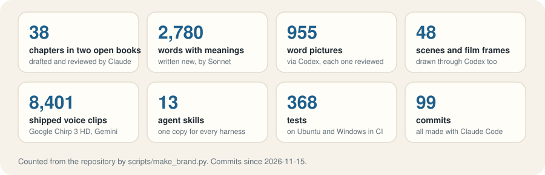
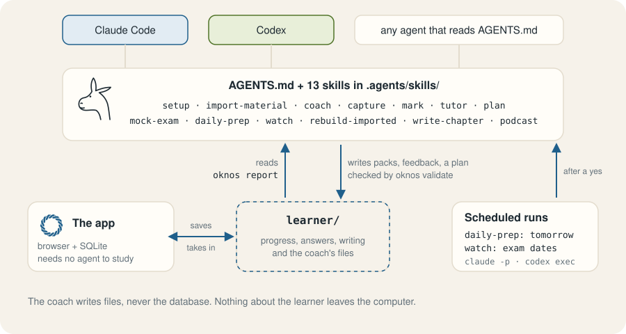
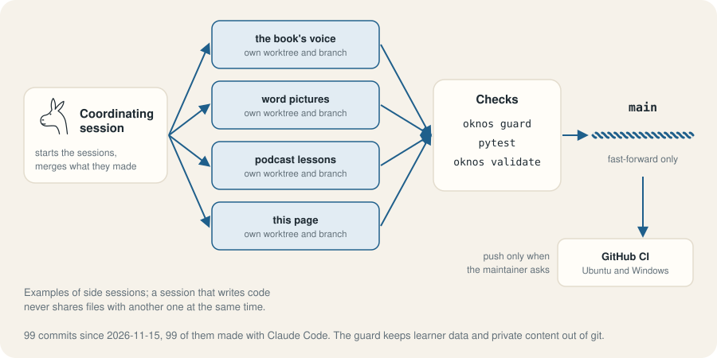

# How Oknos is built: with agents, in the open

Oknos is made and run by coding agents. Claude Code wrote the code, the tests, the docs and the books' text. Codex drew the pictures. Google's speech services voiced what the repo ships. A person, the maintainer, decided what to build, listened, looked and said yes or no. This page says who did what, how, and where the proof is in the repo. The [README](../README.md) is the short version.

<picture>
  <source media="(prefers-color-scheme: dark)" srcset="img/by-the-numbers-dark.svg">
  
</picture>

The numbers are counted from the repository by `scripts/make_brand.py` when the diagrams are made (`uv run --no-sync python scripts/make_brand.py developer`), not typed by hand.

## Contents

1. [Two jobs for agents](#1-two-jobs-for-agents)
2. [The harness: one instruction file, 13 skills](#2-the-harness-one-instruction-file-13-skills)
3. [Who made what](#3-who-made-what)
4. [How the code is built: parallel sessions](#4-how-the-code-is-built-parallel-sessions)
5. [What the agents may not do](#5-what-the-agents-may-not-do)
6. [What is not checked by a person](#6-what-is-not-checked-by-a-person)

## 1. Two jobs for agents

An agent works on Oknos in two roles, and the repo is laid out for both:

- **Building it.** The maintainer develops the app with Claude Code. The app was built phase by phase from written prompts (`docs/prompts/`, from the spec to the podcasts), and every decision is in `docs/DESIGN.md` and `docs/SPEC.md`.
- **Running it for a learner.** A learner with no technical background clones the repo and tells their agent "set this up for me". From then on the agent installs, starts and updates the app, and acts as the learner's Greek coach. The app itself never needs an agent: the daily study session is the web app alone.

## 2. The harness: one instruction file, 13 skills

<picture>
  <source media="(prefers-color-scheme: dark)" srcset="img/harness-dark.svg">
  
</picture>

- **One instruction file for every harness.** [`AGENTS.md`](../AGENTS.md) is the canonical file; `CLAUDE.md` only imports it. It holds the current state, the commands and the guardrails, and it is kept up to date as the work goes on, so a new session starts from the facts.
- **13 skills, one copy each.** The canonical copy of each skill is `.agents/skills/<name>/SKILL.md`, the folder Codex and other harnesses read. `.claude/skills/<name>/SKILL.md` only points to it for Claude Code, and `tests/test_skills.py` keeps the two in step. Each skill starts from what a learner would say ("coach", "mark my writing", "bu dersin podcast'ini yap"):

  | Skill | What it does |
  |---|---|
  | `setup` | installs uv, starts the app, checks it, makes the desktop shortcut |
  | `import-material` | turns a learner's own book or word list into a private pack |
  | `coach` | the check-in: reads the report, marks, reviews flags, writes 10–30 new items and a note |
  | `capture` | a lesson from class, or a photo of a letter, becomes practice, with personal data replaced |
  | `mark` | marks writing and speaking against the exam's criteria |
  | `tutor` | live conversation practice and role-play, also from a phone |
  | `plan` | a week-by-week plan to a real exam date, with an honest verdict |
  | `mock-exam` | a timed mock in the real format, then marks it |
  | `daily-prep` | tomorrow's practice, on a schedule |
  | `watch` | exam and course dates from the official pages |
  | `rebuild-imported` | raw OCR exercises of the learner's own book become checkable items |
  | `write-chapter` | the book's chapters: an outline, Sonnet drafts, an Opus review |
  | `podcast` | a podcast lesson: a script first, then checked, cast and voiced |

  The coaching skills share one rulebook, [`docs/COACHING.md`](COACHING.md).
- **The coach works only through files.** The agent never touches the database. It reads one JSON document, `uv run oknos report` (readiness per exam unit, coverage, the plan's progress, chapters read, recent mistakes). It writes files into the learner's folder: item packs, `feedback/<id>.json`, `coach/plan.json`, a note for the home screen. `uv run oknos validate learner` checks them, including a lint for the Greek, and the app takes them in. So any harness that can read and write files can coach, and a learner's history is never at the mercy of an agent's mistake.
- **Scheduled runs.** With the learner's yes, `uv run oknos schedule add` sets up `daily-prep` (every evening) and `watch` (once a week) in the computer's own scheduler: Windows Task Scheduler, cron, or launchd (the last two written but untested). `uv run oknos run <skill>` starts the agent headless: `claude -p` with a fixed list of allowed tools, or `codex exec`. Every run is logged, and a failed one shows on the home screen.

## 3. Who made what

<picture>
  <source media="(prefers-color-scheme: dark)" srcset="img/who-made-what-dark.svg">
  
</picture>

| Tool | What it did here |
|---|---|
| **Claude Code** (Opus) | Wrote the app (Python, FastAPI, SQLite, a no-build front end), the tests, the docs and the skills. Coordinates the work across sessions. Wrote the golden chapters and reviewed every other chapter. Reviews every picture. Writes the podcast scripts. Every commit in this repo was made with it. |
| **Claude Code subagents** (Sonnet) | Drafted the book chapters from an approved outline, 3–5 at a time. Wrote the meanings of the book's 2,780 words, and the glossary of the words the open content shows. |
| **Codex** (its image model) | Drew the word pictures, the story's scenes and the films' frames. Claude Code starts it headless with a short brief. |
| **Google Cloud Text-to-Speech** (Chirp 3 HD) | Voiced every Greek text of the open content: the clips in `content/open-voice/`, so a fresh clone sounds right with no key. Voices the book's shipped podcast episodes (`content/open-podcasts/`). |
| **Gemini TTS** | Voiced the films' published narration (`docs/brand/animations/voice/`), and takes over podcast lines as its daily quota allows. |
| **Plain code, no model** | The film player (`film.js`), the films' background sound (`scripts/film_ambience.py`), the brand and these diagrams (`scripts/make_brand.py`), the screenshots (`scripts/readme_images.py`). |

### The books

- **The procedure** is the `write-chapter` skill ([`.agents/skills/write-chapter/SKILL.md`](../.agents/skills/write-chapter/SKILL.md)) and [`docs/LESSONS.md`](LESSONS.md): an approved outline, a few golden chapters written by Opus as the model to follow, Sonnet subagents drafting one stage each, then an independent Opus review against a written checklist (Greek, teaching, the section order, validation) with a review note per chapter.
- **The Oknos book**, 26 chapters (`content/open/oknos-book/`), is the default course. Lessons 1 and 2 were written by Opus, the rest drafted by Sonnet. The review made 170 Greek fixes and 191 teaching fixes in all, about 7 of each per chapter. In the pilot batch a Sonnet draft took about 150–190k tokens and an Opus review about 140–165k. The errors the review caught were in rules and descriptions (final -ν, the vocative, how phone numbers are read, a word's stress) more than in spelling, which is why the review step stays.
- **Made original.** The Oknos book was first written privately to follow a commercial textbook's syllabus. Before it was opened under CC BY-SA 4.0, its text was checked against every source of that textbook we had (its text layer, its OCR extractions and its tests): 46 of 10,522 six-word runs matched (0.44%), all pronoun and article lists, counting and stock phrases. Opus then reviewed all 26 chapters against the textbook's lesson text; about 25 passages close in structure or reusing its examples were rewritten, and every new name and place was checked. The book's own review notes stay private, with the rest of that textbook's material.
- **The open course's book**, 12 chapters with a story running through it (`content/open/open-book/`), was written the same way and is original throughout. Its review notes are in [`content/open/open-book/lessons/review/`](../content/open/open-book/lessons/review/): 14 Greek fixes and 26 teaching fixes in all.
- **Word meanings.** The book's 2,780 words have meanings written new from the Greek by Sonnet, never copied from a list's glosses; 24 doubtful ones are marked `needs_review`.

### The pictures

- **The brief** is [`docs/brand/IMAGES.md`](brand/IMAGES.md): flat illustration, the app's palette, no text or letters anywhere (image models garble Greek), no real people. Each prompt is a fixed template with the subject filled in.
- **The loop.** Claude Code writes a batch of about 24 requests, then starts Codex headless (`codex exec --cd <repo> --sandbox workspace-write "Follow the task in <brief>"`) in the background. Codex draws one picture per request and records the prompt it used. Claude Code looks at every picture against the brief and accepts or rejects it with a reason; the maintainer can overrule. About 1 in 20 was rejected and asked for again. A word that failed twice got a prompt saying what it must not look like, with two variants to choose from. `scripts/pictures.py` takes the accepted ones in as 512×512 WebP, about 15 KB each.
- **What it costs.** A batch of 24 takes about 30 minutes. One five-hour Codex limit on a ChatGPT Plus plan covered about 100 pictures.
- **The story's people** have a fixed look written in [`docs/brand/CHARACTERS.md`](brand/CHARACTERS.md) and a reference sheet in `docs/brand/characters/`, attached to every scene prompt so Zeynep looks like Zeynep in every chapter.

### The films

Three short painted films about the app's name: two from Pausanias and one new (the app shows two; one is archived). They are **motion comics**: illustrations with a slow camera move, cross-fades and captions in simple modern Greek with a Turkish or English line ([`docs/brand/animations/`](brand/animations/README.md)). The frames were drawn through Codex from written storyboards with the cast's reference sheets attached, and reviewed one by one; 8 of 28 were drawn again (a rope that changed colour, a donkey eating grass instead of rope). The player is `film.js`: no libraries, no build.

The background sound is **made from numbers**. `scripts/film_ambience.py` builds the wind, the cicadas and the goat bells from seeded noise and sine waves, with only the standard library and ffmpeg, so the same command always makes the same files. Nothing is recorded or downloaded.

### The voices

- **What ships** has to be publishable. The open content's clips are Google Chirp 3 HD (Kore, Orus), and the films' narration is Gemini TTS. `oknos guard` reads each audio manifest and fails if a tracked clip was made by a service whose terms do not allow passing it on.
- **What the maintainer hears** at home is chosen by ear: ElevenLabs v4 for their own clips and podcasts (Azure before). Its audio stays on their computer.
- **Chosen by listening.** Several listening tests settled this ([`docs/VOICE.md`](VOICE.md), [`docs/PODCASTS.md`](PODCASTS.md)): ten sentences in eight voices ranked by ear; seven setups scored on podcast excerpts, which Gemini won; then three takes of the same lesson, labelled, where ElevenLabs v4 won.
- **A learner's own voice** uses their own key (Azure, Google, Gemini, ElevenLabs or OpenAI). The service is sent the Greek content text only, never anything about the learner.

### The podcasts

An episode is a script first (`script.json`: parts, lines in Greek, Turkish or English, speakers, speed, pauses, gaps to repeat). The agent writes it with the `podcast` skill from the chapter. `uv run oknos podcast check` checks it and prints the characters a render will spend. `render` casts each person a voice of their own (`src/oknos/casting.py`), voices the lines a service can act together as one dialogue, and joins it all with ffmpeg into one mp3 for the app's Podcast page. A learner's episodes are made with their own keys and stay in `learner/`. The book's 26 chapter episodes also ship with the repo (`content/open-podcasts/`), voiced by Google only, so a fresh clone can listen with no key.

## 4. How the code is built: parallel sessions

<picture>
  <source media="(prefers-color-scheme: dark)" srcset="img/how-it-is-built-dark.svg">
  
</picture>

- **One coordinating session, many side sessions.** The maintainer talks to one Claude Code session, often from a phone. It splits the work into side sessions (the book's voice, a batch of pictures, the podcasts, this page), each in its own git worktree on its own branch, and keeps a shared notes folder outside the repo for hand-overs. Two sessions that write code never touch the same files at the same time.
- **Short branches, fast-forward only.** A side session commits on its branch and rebases onto `main`; the coordinating session fast-forwards `main` and deletes the branch. Nothing is pushed until the maintainer asks.
- **The checks.** `uv run oknos guard` fails if git tracks anything under `learner/` or `content/private/`, a local user path, or audio a service does not let us publish. `uv run pytest` runs the tests, including a scripted two weeks of use, with nothing from a real learner or a signed-in agent. `uv run oknos validate content/open` checks every pack and chapter: the schema, the Greek lint, exam tags, and lists any Greek word on screen that has no meaning. The pre-push hook in `.githooks/` runs the guard, and CI ([`.github/workflows/ci.yml`](../.github/workflows/ci.yml)) runs all three on Ubuntu and Windows.
- **The agent's memory is the repo.** `AGENTS.md` is updated as the work lands (the current state, the numbers, the known limits), so the next session, in any harness, starts from what is true now.

## 5. What the agents may not do

These are rules in `AGENTS.md`, and the code holds most of them:

- **Write the database.** The coach writes files; the app decides what to take in.
- **Send learner data anywhere.** No accounts, no telemetry, no cloud that holds learner data. A voice service gets the Greek text to read and nothing else.
- **Publish the app.** It listens on `127.0.0.1` only. A learner's own devices can reach it through their private network (Tailscale Serve), never a public tunnel; `oknos start` only reads that setting, never changes it.
- **Commit private material.** The guard stops it, in the tests, the pre-push hook and CI.
- **Push, or set up a schedule, without a yes.** Scheduled runs wait for the learner's yes, and pushes wait for the maintainer's.

Also installed on the maintainer's computer: Antigravity and its CLI (Gemini). Nothing in this repo was made with them so far.

## 6. What is not checked by a person

Said plainly, so nobody mistakes it for more:

- The books' text was reviewed by Opus against a checklist, not by a Greek teacher. The maintainer reads the chapters as the lessons come, and any section can be flagged in the app with one tap (⚑), which sends a fix to the coach.
- The word meanings and the glossary were written by Sonnet and spot-checked by Opus.
- The pictures were reviewed by Claude Code, and by the maintainer where they looked.
- The readiness scores for writing and speaking are the coach's estimates, labelled as such, because neither exam publishes its full marking.
